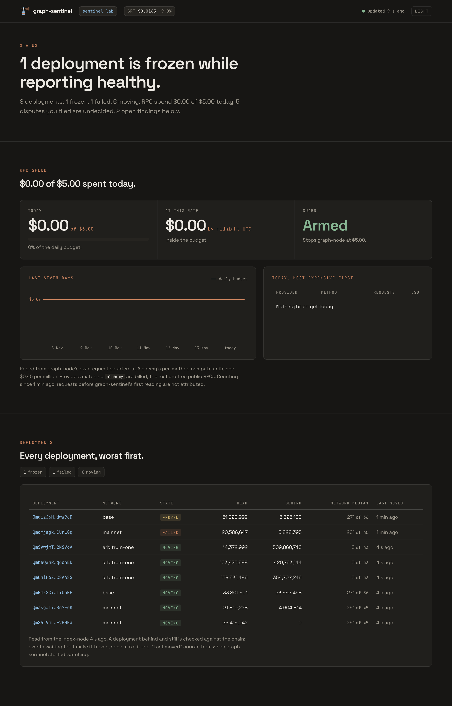

# graph-sentinel

**The monitor for the failures that pass every other monitor.**

graph-sentinel is a read-only daemon an indexer on The Graph runs beside graph-node,
indexer-agent, indexer-service and tap-agent. It checks what the stack *says* against what the
chain, the oracle and the payment rail *show*, and tells you, on Telegram, Discord, Slack or your
own agent, when they disagree.

It holds no keys, signs nothing, and changes nothing upstream. One indexer can run it today
without anybody else adopting anything.

[Support my work <3](https://github.com/sponsors/cargopete)



## Why it exists

Every one of these happened to a working indexer in 2026, and in every case Grafana was green,
the index-node said `healthy`, and money was lost anyway.

| What happened | What it cost | What graph-sentinel raises |
| --- | --- | --- |
| A Postgres blip poisons a deployment's writer; graph-node keeps reporting it `healthy` ([graph-node #6730](https://github.com/graphprotocol/graph-node/pull/6730)). One indexer closed twelve consecutive allocations on one frozen deployment. | Stale POIs, dispute exposure, lost rewards | `frozen` |
| The Rewards Eligibility Oracle went from 1 to 5 to 10 qualifying subgraphs a day, applied retroactively to a 28-day window. At launch 47 of 97 indexers had not qualified. | Rewards withheld for the whole period | `reo_at_risk`, `reo_ineligible`, `reo_oracle_disagrees` |
| The mainnet TAP aggregator served a Cloudflare 526 page to gRPC clients. Fees climbed past the loss limit and indexers' own tap-agents denylisted the gateway. | Hours of zero routing | `aggregator_down`, `fees_near_limit`, `sender_denylisted` |
| The Foundation rotated the gateway sender on 2026-09-24. Indexers who missed it kept serving and were never paid. | Days of unpaid queries | `unknown_sender` |
| tap-agent silently stops requesting RAVs for one sender ([indexer-rs #1094](https://github.com/graphprotocol/indexer-rs/issues/1094)). | Fees never aggregated | `rav_stalled` |
| An allocation drifts past the 28-day POI limit, or a dispute is filed and nobody is watching the forum. | Rewards for the gap; a slashed bond | `poi_due`, `poi_stale`, `dispute_against` |

The full catalogue, with sources, is in [RFC-0001](docs/RFC-0001-indexer-sentinel.md).

## What it watches

| Module | Turns on with | Catches |
| --- | --- | --- |
| **Liveness** | `index_node_url` (plus an RPC per chain to tell frozen from idle) | Deployments `frozen` while reported healthy, `stalled`, `stopped`, `failed`; a `chain_stalled` head; the index-node down. Probes `eth_getLogs` over each manifest's addresses and topics, so a quiet contract is not mistaken for a frozen one. Optional `graphman restart`, off by default. |
| **REO meter** | `indexer_address` and tap-agent's database | Distinct deployments served per UTC day against the oracle's minimum, projected forward; the next runs that fail; the cheapest deployments to add. Keeps its own ledger, because tap-agent deletes receipts once a RAV covers them. |
| **Payments** | tap-agent's database, optionally your indexer-rs `config.toml` | Aggregators probed as real gRPC servers, unknown senders, the denylist, fees against `max_amount_willing_to_lose_grt`, stalled RAVs, escrow running low, config mistakes. |
| **Network view** | a gateway API key | Provision, delegation, every open allocation with its POI deadline, disputes against you and, with a fisherman address, the ones you filed. |
| **RPC spend guard** | graph-node's metrics endpoint and a daily budget | Metered RPC spend per method, projected; at the budget it can run your stop command and resume after midnight UTC. |

Each finding carries its evidence and a **remedy**: typed steps (a check, a command and the host
it belongs on, a config edit, a SQL statement, or something only a person can do), a risk level,
and how to tell it worked. graph-sentinel never runs them. It proposes; you, or your agent with
your approval, act.

## Try it without an indexer

`demo/` runs a whole simulated indexer stack: graph-node, an RPC, the network subgraph, a TAP
aggregator, and a tap-agent writing indexer-rs's real tables in Postgres. Then you break it on
cue.

```sh
cd demo && docker compose up -d --build
open http://127.0.0.1:9477/
./incident.sh                    # lists what you can break
./incident.sh freeze             # a deployment stops while graph-node calls it healthy
./incident.sh aggregator-down    # the aggregator serves a Cloudflare page instead of gRPC
./e2e.sh                         # breaks each in turn and times detection and recovery
```

Measured with `./e2e.sh` against the demo's short intervals (15 s ticks), 2026-11-14:

| Incident | Finding | Raised | Cleared |
| --- | --- | --- | --- |
| a deployment stops while graph-node calls it healthy | `frozen` | 22 s | 30 s |
| a deployment fails with a fatal error | `failed` | 15 s | 31 s |
| the chain head stops | `chain_stalled` | 42 s | 31 s |
| receipts from a sender the config does not know | `unknown_sender` | 16 s | 33 s |
| tap-agent stops requesting RAVs | `rav_stalled` | 58 s | 31 s |
| a dispute is filed against the indexer | `dispute_against` | 30 s | 61 s |
| an allocation nears its POI deadline | `poi_due` | 28 s | 61 s |
| the oracle marks the indexer ineligible | `reo_ineligible` | 61 s | 118 s |
| a sender's escrow runs low | `escrow_low` | 16 s | 30 s |
| the aggregator serves a Cloudflare page | `aggregator_down` | 31 s | 30 s |

On a real stack the default intervals are longer, so expect minutes rather than seconds.

## On a real graph-node

On 2026-11-14 it ran against graph-node v0.45.0 with eight real deployments on Arbitrum One,
Base and mainnet. Two things came of it:

- **A false positive, now fixed.** A syncing deployment commits its head once per write batch
  (`GRAPH_STORE_WRITE_BATCH_DURATION`, 300 s by default), so the index-node showed busy
  deployments standing still, and the first build called four of them frozen. Liveness now reads
  graph-node's in-memory `deployment_head` from the metrics port, and without it waits out one
  batch before saying anything worse than idle. Point `[liveness] graph_node_metrics_url` (or
  `[spend]`'s) at port 8040.
- **A true positive nobody staged.** One deployment's runner died at start for want of a `traces`
  provider; graph-node logged it once and has reported the deployment `healthy` ever since.
  graph-sentinel raised `frozen` within a minute.

## Install

The full path, including Telegram, Discord and the read-only Postgres role, is
[docs/install.md](docs/install.md). Beside an existing Docker indexer stack:

```sh
git clone https://github.com/nuthatch-org/graph-sentinel
cd graph-sentinel/deploy/compose
cp graph-sentinel.toml.example graph-sentinel.toml && cp .env.example .env   # then edit both
docker compose up -d
docker compose exec graph-sentinel graph-sentinel doctor
```

The smallest useful config is one line:

```toml
[sources]
index_node_url = "http://index-node-0:8030/graphql"
```

A fuller one:

```toml
[sources]
indexer_address = "0x…"
indexer_postgres_url = "postgres://sentinel_ro:…@postgres-agent:5432/indexer"   # tap-agent's database
index_node_url = "http://index-node-0:8030/graphql"
network_subgraph_token_env = "GRAPH_API_KEY"

[sources.rpc]
"arbitrum-one" = "https://arb1.arbitrum.io/rpc"
"mainnet" = "https://rpc.example.org/v1/evm/1/${RPC_KEY}"   # ${VAR} comes from the environment

[liveness]
graph_node_metrics_url = "http://index-node-0:8040/metrics"   # the in-memory head; see "On a real graph-node"

[outputs]
listen = "127.0.0.1:9477"                      # dashboard, /api/snapshot, /metrics, /mcp
public_url = "https://sentinel.example.org"    # linked from every notification

[[outputs.notify]]
kind = "telegram"
bot_token_env = "TELEGRAM_BOT_TOKEN"
chat_id = "-1001234567890"

[[outputs.notify]]
kind = "discord"
url_env = "DISCORD_WEBHOOK_URL"
min_severity = "critical"
```

From source, with Rust 1.94 or later:

```sh
cargo build --release && ./target/release/graph-sentinel
```

On start it posts a short "watching" message to every channel, so you know the wiring works.
After that it posts when a finding appears, escalates or clears, never on a timer. Channels are
`telegram`, `discord`, `slack` and `generic` (JSON for Alertmanager and the like), each with a
`min_severity`.

## Ask your agent

If you run Claude Code, Codex or any other MCP client on your indexer box, point it at
graph-sentinel and ask it what is wrong. It gets the findings, the evidence and the remedies
rather than a pile of graph-node logs.

Over HTTP, from the daemon itself:

```sh
claude mcp add --transport http graph-sentinel http://127.0.0.1:9477/mcp
```

Over stdio, for clients that prefer it, or when the dashboard is only reachable inside the
container:

```sh
claude mcp add graph-sentinel -- docker compose exec -T graph-sentinel graph-sentinel mcp
claude mcp add graph-sentinel -- graph-sentinel mcp --url http://127.0.0.1:9477
```

The tools are `overview`, `findings`, `deployments`, `reo`, `network`, `payments`, `rpc_spend`
and `sources`, all read-only. The server tells the agent to start with `overview`, and that
anything above low risk needs your approval. This is the remedy `findings` returned in the demo
after `./incident.sh rotate-sender`:

```json
{
  "risk": "medium",
  "steps": [
    { "type": "config", "file": "indexer-rs config.toml",
      "section": "[tap.sender_aggregator_endpoints]",
      "change": "\"0x4b1d0000000000000000000000000000000c0ffe\" = \"<the sender's aggregator URL>\"" },
    { "type": "command", "run": "docker compose restart tap-agent", "on": "tap-agent host" }
  ],
  "verify": "RAVs appear for the sender."
}
```

The server refuses requests from a browser on another origin, and has no login, like the
dashboard: keep it on loopback or behind your own proxy.

## Command line

`graph-sentinel` with no argument runs the daemon. The rest are for scripts and debugging, and
take `--json`:

| Command | Does |
| --- | --- |
| `doctor` | Tests every configured source and says which modules are off, and why |
| `status` | Every active finding |
| `reo`, `reo candidates`, `reo history` | The figures on the REO panel |
| `mcp` | The MCP server on stdio |

## What it does not do

- **It does not check POIs against a reference yet.** The POI self-consistency gate (Module 2 of
  the RFC) is designed and not built. Deadlines and disputes are watched; whether the POI itself
  is right is not.
- **The REO count is an upper bound.** It comes from TAP receipts, which do not record latency or
  freshness. When the oracle declines a run the receipts said should pass, you get
  `reo_oracle_disagrees` rather than silence.
- **History starts when graph-sentinel does.** tap-agent deletes receipts once a RAV covers them,
  so keep it running.
- **The payment and REO modules have not met a production indexer.** They are tested against
  fixtures, indexer-rs's real migrations in Postgres, live oracle reads and `demo/`. Liveness and
  the network view have run against a real graph-node. Reports from real stacks are the most
  useful issue you can file.
- **The RPC spend guard prices only providers it knows** (Alchemy-style compute units). Others,
  GraphOps among them, count as free.

## Layout

| Crate | Role |
| --- | --- |
| `graph-sentinel` | the binary: daemon, dashboard, notifications, MCP server, local state, metrics, CLI |
| `sentinel-sources` | Postgres, index-node, network subgraph and RPC clients |
| `sentinel-checks` | the check modules and their remedies; pure logic, tested against fixtures |
| `sentinel-types` | `Finding`, `Severity`, ids |

Design: [RFC-0001](docs/RFC-0001-indexer-sentinel.md). Progress:
[docs/progress-log.md](docs/progress-log.md). Tasks run with
[yatr](https://yetanothertaskrunner.com): `yatr ci` is what CI runs.

## Licence

MIT OR Apache-2.0.
